<p align="center">
  
</p>

<h1 align="center">Pursae</h1>

<p align="center"><b>WordPress, rewritten in Go.</b><br>
The admin you already know, on one binary and PostgreSQL, with 18 plugins built in and no PHP anywhere.</p>

<p align="center">
  
  
  
  
  
</p>

<p align="center">
  <a href="#quick-start">Quick start</a> ·
  <a href="#why-pursae">Why Pursae</a> ·
  <a href="#tour">Tour</a> ·
  <a href="#built-in-plugins">Plugins</a> ·
  <a href="#ai-agents-mcp">AI agents</a> ·
  <a href="#what-pursae-sends-to-hubpursaecom">Privacy</a> ·
  <a href="docs/GUIDE.md">Full guide</a> ·
  <a href="docs/developer/README.md">Developer docs</a>
</p>

<p align="center">
  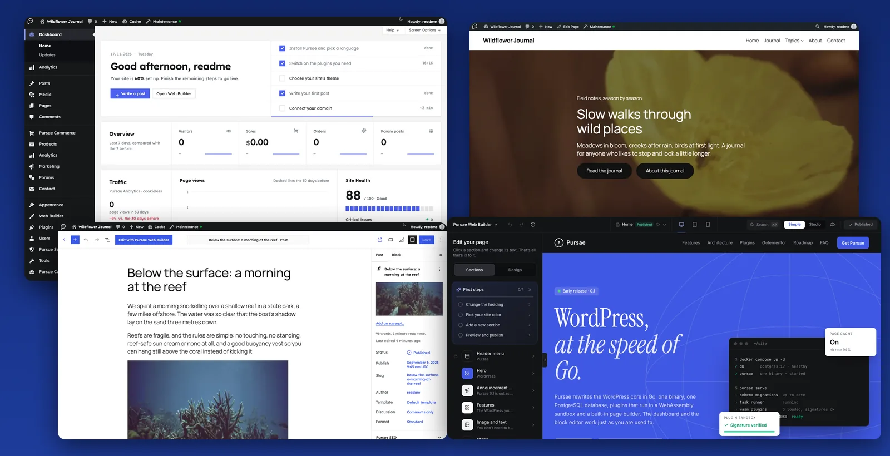
</p>

## Quick start

You need Docker (with Compose v2), git and make.

**On a server** (production build, updates from hub.pursae.com, behind your TLS proxy):

```sh
git clone https://github.com/pursae/pursae.git && cd pursae
cp .env.example .env                  # set PURSAE_DB_PASSWORD, PURSAE_SITE_URL (https://…), SMTP
docker compose up -d --build          # → 127.0.0.1:8088; point Caddy or nginx at it
```

The installer is locked with a setup token: open the install link the server prints on its first start
(`docker compose logs pursae`, a line like `https://example.com/wp-admin/install?token=…`), or set your own
`PURSAE_SETUP_TOKEN` in `.env`. Lost the link? `docker compose exec pursae pursae setup-token` prints a new one.
Updates arrive in **Dashboard › Updates** (one click); data lives in Docker volumes. Every setting is listed
in [`.env.example`](.env.example).

**On your machine** (development build to try it out; it does not talk to hub.pursae.com):

```sh
make docker-up                        # → http://localhost:8088
```

Ports, env vars, proxies, backups: **[docs/GUIDE.md](docs/GUIDE.md)**.

## Why Pursae

<table>
<tr>
<td width="25%" align="center"><h3>🐹</h3><b>One Go binary</b><br><sub>No PHP, no FPM, no extensions. Admin, editors and bundled themes are embedded.</sub></td>
<td width="25%" align="center"><h3>🐘</h3><b>PostgreSQL 16 or 17</b><br><sub>Typed schema, JSONB, migrations on start.</sub></td>
<td width="25%" align="center"><h3>🧩</h3><b>Wasm plugins</b><br><sub>Signed, sandboxed, permission-gated.</sub></td>
<td width="25%" align="center"><h3>🚀</h3><b>Fast by default</b><br><sub>Built-in page cache, static Web Builder output. <a href="#performance-benchmarks">Numbers</a>.</sub></td>
</tr>
<tr>
<td align="center"><h3>🖥️</h3><b>The admin you know</b><br><sub>The classic WordPress admin, 1:1, under <code>/wp-admin/</code>.</sub></td>
<td align="center"><h3>📦</h3><b>Batteries included</b><br><sub>Store, SEO, security, forum, forms, backups and more, without installing a plugin first.</sub></td>
<td align="center"><h3>🤖</h3><b>AI-ready</b><br><sub>A built-in MCP server lets Claude, Cursor and other clients run the site.</sub></td>
<td align="center"><h3>🛡️</h3><b>Secure by default</b><br><sub>argon2id, login throttling, CSP, security headers, signed packages.</sub></td>
</tr>
</table>

## Tour

The first admin login greets you with the **Welcome to Pursae** card above. The screenshots below use the **Classic**
admin theme, the WordPress look and the default. **Pursae Modern** is an optional beta theme: pick it under
**Users › Profile › Administration Theme**.

<table>
<tr>
<td width="50%">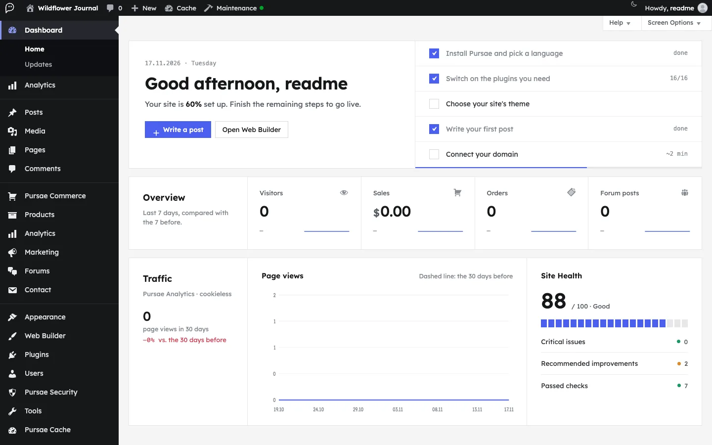<p align="center"><b>Dashboard</b> — the classic WordPress admin, 1:1</p></td>
<td width="50%">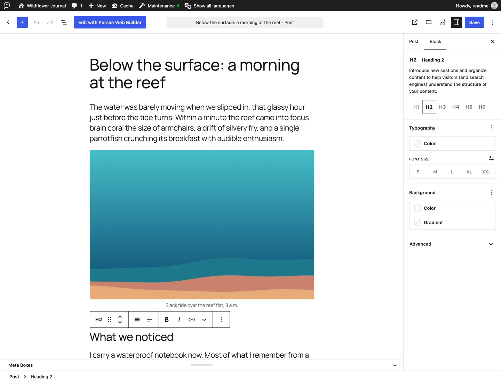<p align="center"><b>Pursae Editor</b> — the real block editor</p></td>
</tr>
<tr>
<td>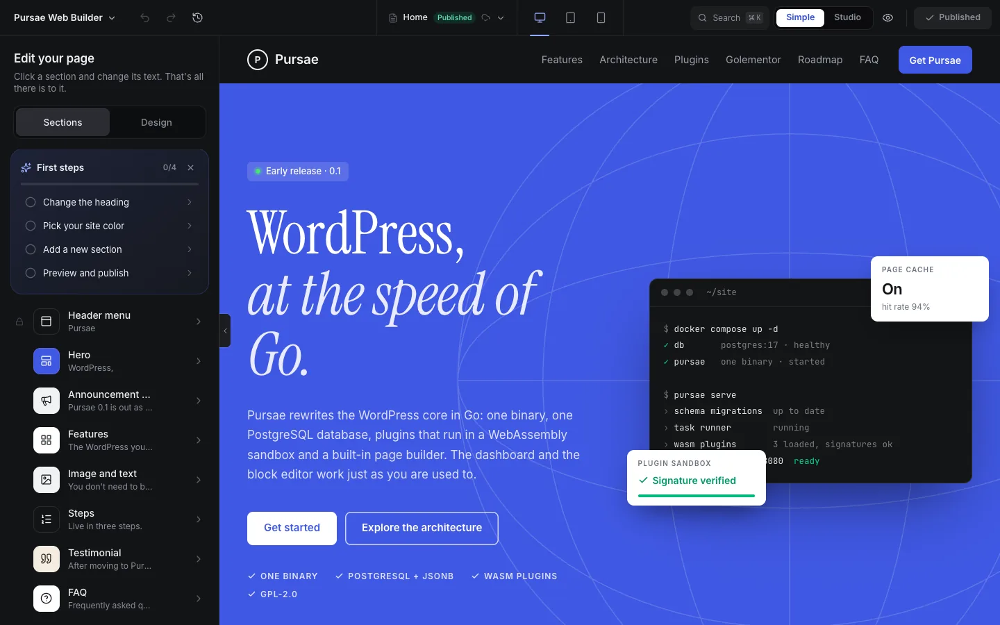<p align="center"><b>Pursae Web Builder</b> — visual pages, static output</p></td>
<td>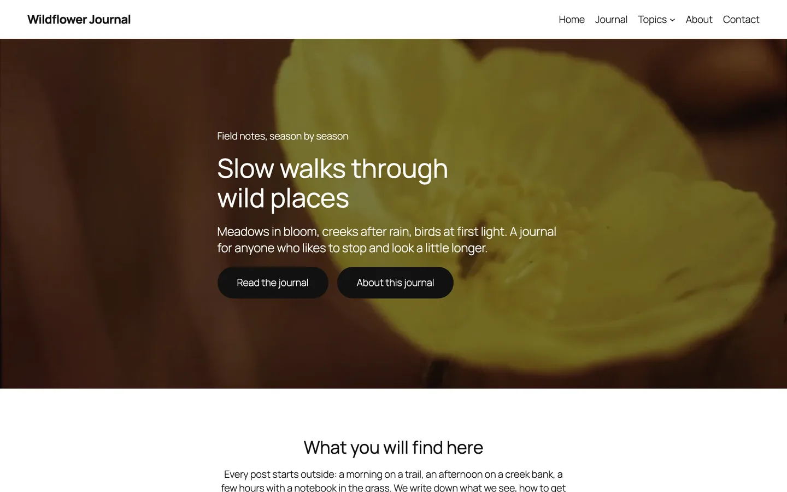<p align="center"><b>Twenty Twenty-Five</b> — demo content in one click</p></td>
</tr>
</table>

<details>
<summary><b>More core screens</b> — posts, media, themes, menus, plugins, users, health, settings</summary>
<br>
<table>
<tr>
<td width="50%">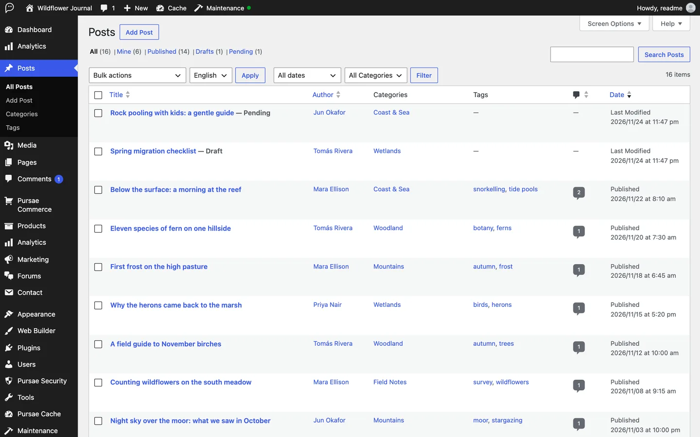<p align="center">Posts</p></td>
<td width="50%">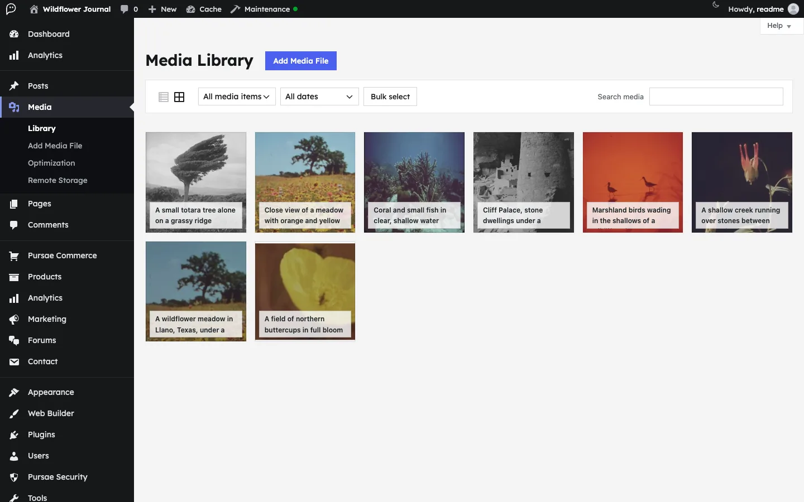<p align="center">Media Library</p></td>
</tr>
<tr>
<td>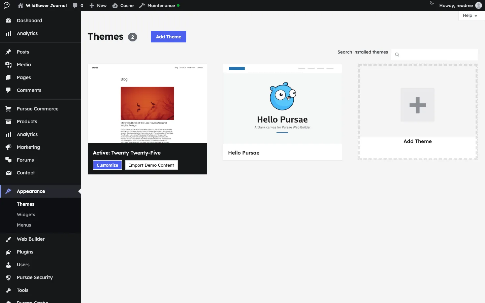<p align="center">Themes</p></td>
<td>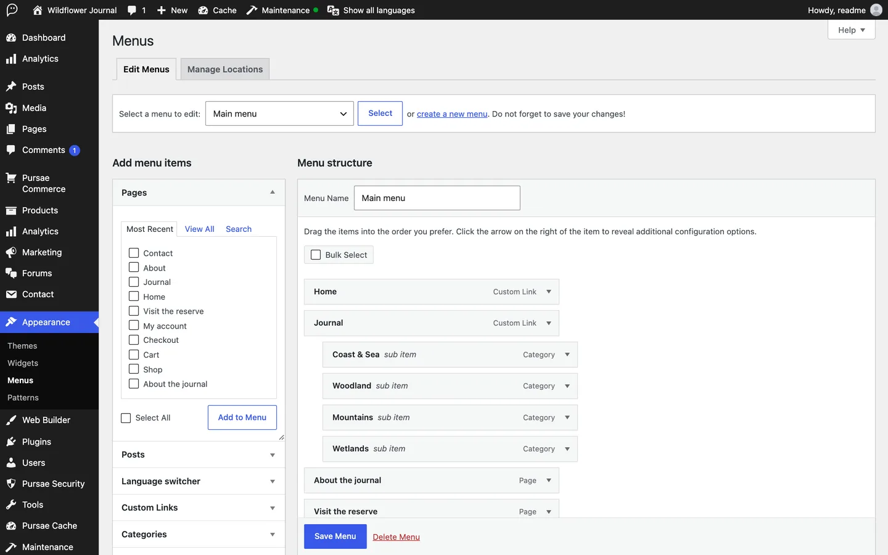<p align="center">Menus</p></td>
</tr>
<tr>
<td>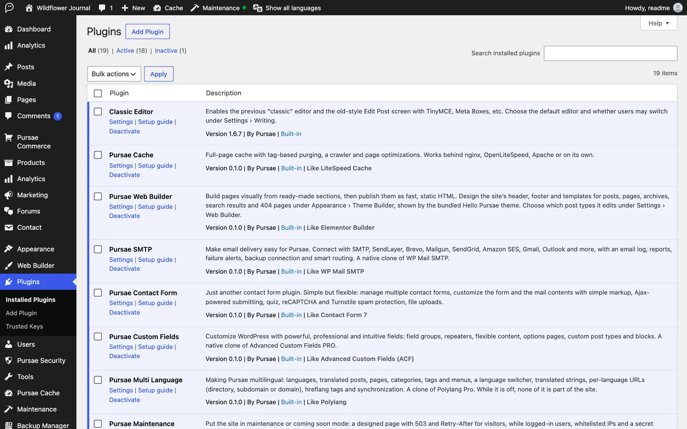<p align="center">Plugins</p></td>
<td>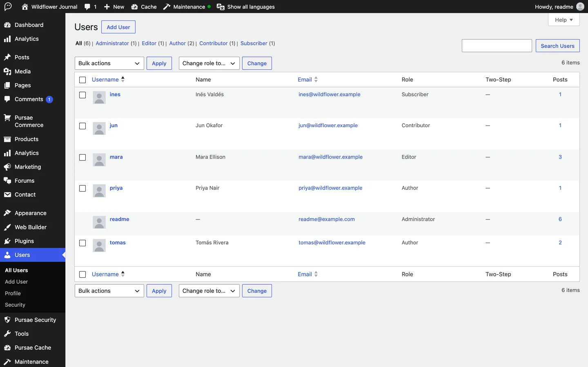<p align="center">Users &amp; multi-role</p></td>
</tr>
<tr>
<td>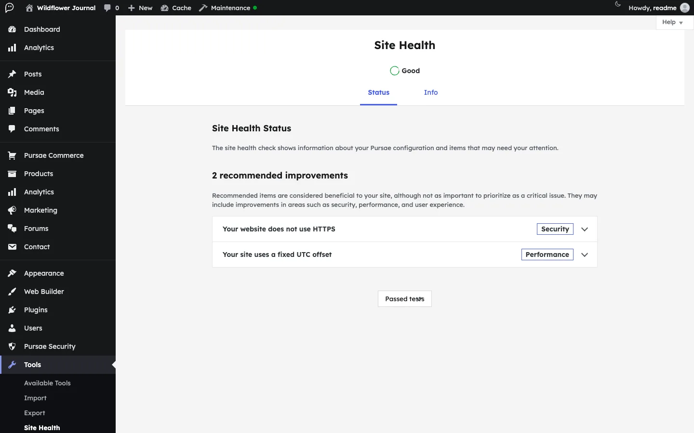<p align="center">Site Health</p></td>
<td>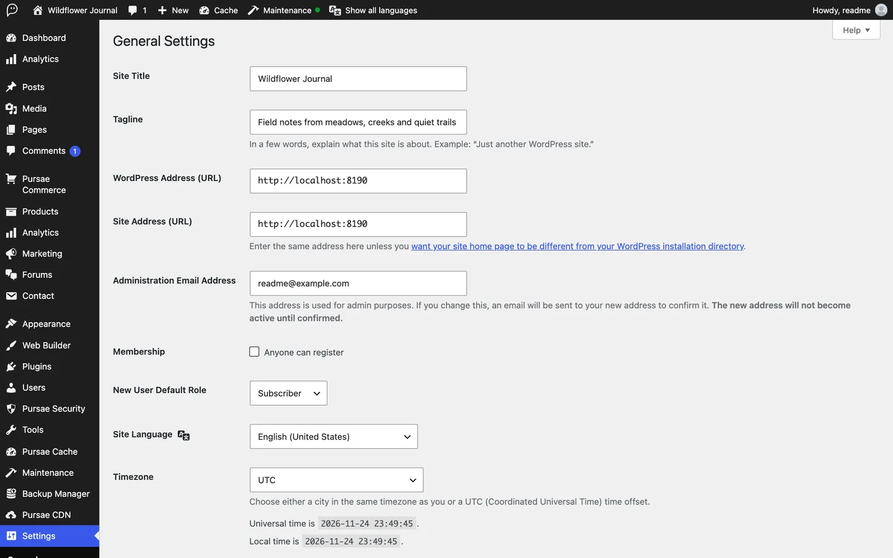<p align="center">Settings</p></td>
</tr>
</table>
</details>

## Built-in plugins

Native, switched on and off with one click under **Plugins**. All of them are off on a fresh install except
Pursae Cache and Classic Editor. Each name below jumps to its section, with screenshots.

| | Plugin | In one line | Docs |
|---|---|---|---|
| 🛒 | **[Pursae Commerce](#pursae-commerce)** | Store, cart, checkout, orders, bookings & premium modules | [→](docs/goocommerce-features.md) |
| 🎨 | **[Pursae Web Builder](#pursae-web-builder)** | Visual pages, Theme Builder, popups, theme library | [→](docs/developer/web-builder.md) |
| 🔎 | **[Pursae SEO](#pursae-seo)** | Analysis, schema, sitemaps, redirects | [→](docs/seo-go-features.md) |
| ⚡ | **[Pursae Cache](#pursae-cache)** | Full-page cache + page optimization | [→](docs/developer/operations/caching.md) |
| 🛡️ | **[Pursae Security](#pursae-security)** | 2FA, MFA codes, lockouts, activity log | [→](docs/adminsecgo-features.md) |
| ☁️ | **[Pursae CDN](#pursae-cdn)** | S3/R2 offload, image service, purge | [→](docs/gocdn-features.md) |
| 🔌 | **[Pursae Headless](#pursae-headless)** | Content types, REST, GraphQL, webhooks | [→](docs/headlessgo-features.md) |
| 🍪 | **[Pursae Cookie](#pursae-cookie)** | GDPR/KVKK banner, Consent Mode v2 | [→](docs/gooike-features.md) |
| 📈 | **[Pursae Pixel](#pursae-pixel)** | Meta, GA4, Ads, TikTok + server-side | [→](docs/pixelgo-features.md) |
| 📊 | **[Pursae Analytics](#pursae-analytics)** | Cookieless stats + real-user Core Web Vitals | [→](docs/analytics-features.md) |
| 💬 | **[Pursae Forum](#pursae-forum)** | Forums, email + Google sign-up, levels & badges | [→](docs/forum-features.md) |
| ✉️ | **[Pursae SMTP](#pursae-smtp)** | Mailers, email log, reports | [→](docs/wpgo-mail-smtp-features.md) |
| 🗂️ | **[Pursae Custom Fields](#pursae-custom-fields)** | Field groups, CPTs, options pages | [→](docs/acf-go-features.md) |
| 🌍 | **[Pursae Multi Language](#pursae-multi-language)** | Languages, translations, hreflang | [→](docs/golylang-features.md) |
| 📝 | **[Pursae Contact Form](#pursae-contact-form)** | Forms, mail templates, spam guard | [→](docs/gontact-form-features.md) |
| 🚧 | **[Pursae Maintenance](#pursae-maintenance)** | Maintenance / coming-soon page | [→](docs/maintenance-go-features.md) |
| 💾 | **[Pursae Backup Manager](#pursae-backup-manager)** | One-click backup &amp; migrate | [→](docs/backup-manager-features.md) |
| 📄 | **[Classic Editor](#classic-editor)** | TinyMCE editing, per-user switch | — |

### Pursae Commerce

A WooCommerce-style store built into the binary: products, cart, checkout, tax, shipping, coupons, orders and
payment gateways, with the premium extensions included as modules.

- Orders, products and the rest live in dedicated tables; both REST APIs are there, with `wc/v3` for existing tooling.
- Fourteen modules under **Commerce › Extensions**, all off by default: Bookings, Subscriptions, Memberships, Gift Cards, Product Bundles, Pre-Orders, Product Add-Ons, Dynamic Pricing, Table Rate Shipping, PDF Invoices & Packing Slips, Points and Rewards, Wishlists, Product Compare and Quick View.
- Store pages render inside the active theme, keep WooCommerce's markup and classes, and `woocommerce_*` shortcodes still work.
- Cart and Checkout blocks, an Analytics screen, and CSV and WXR import.

<table>
<tr>
<td width="50%">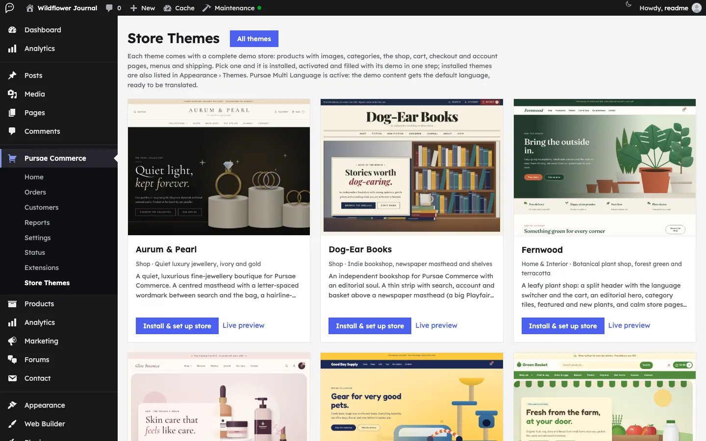<p align="center">Store themes with a full demo shop</p></td>
<td width="50%">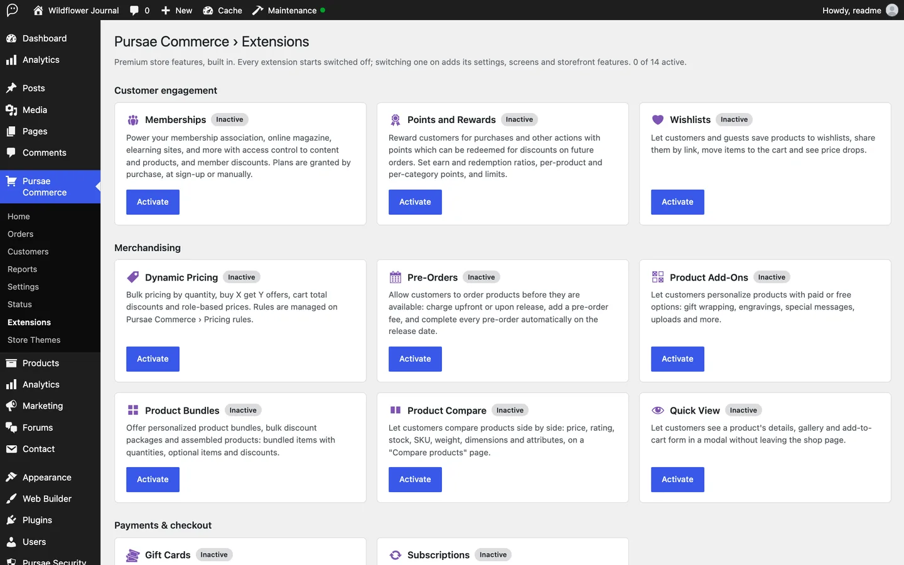<p align="center">Premium modules, built in</p></td>
</tr>
<tr>
<td>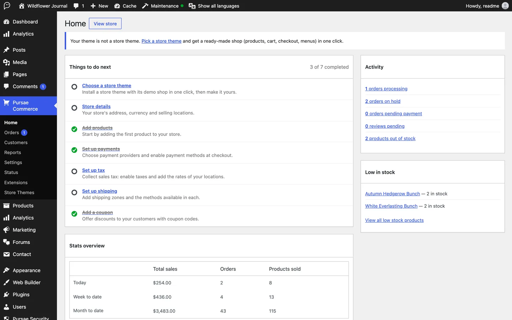<p align="center">Home &amp; setup tasks</p></td>
<td>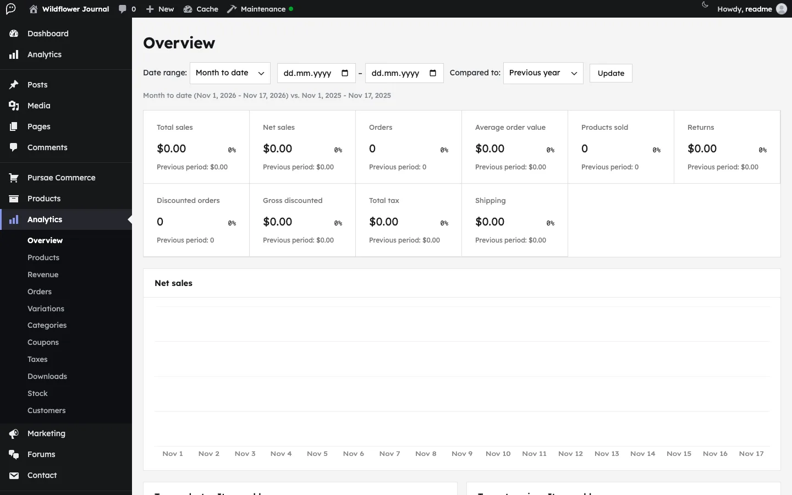<p align="center">Analytics</p></td>
</tr>
<tr>
<td>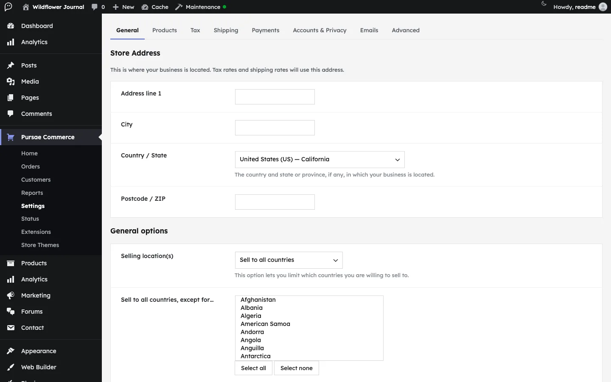<p align="center">Settings</p></td>
<td></td>
</tr>
</table>

<p align="right"><a href="docs/goocommerce-features.md">All Commerce features →</a></p>

### Pursae Web Builder

A section-based visual page builder. Visitors never load the editor: a published page is a static HTML/CSS
snapshot with a small optional script.

- Build pages from sections (navigation, hero, features, FAQ, call to action, footer and more) or saved library sections, with desktop, tablet and mobile views; changes autosave as your own draft.
- **Theme Builder** designs the header, footer and content templates, shown by the bundled **Hello Pursae** theme.
- Images come from the Media Library; Google Fonts are downloaded once and served from your site.
- Import a theme from the theme library, or an HTML design 1:1.

<table>
<tr>
<td width="50%"><p align="center">Sections, design, devices</p></td>
<td width="50%">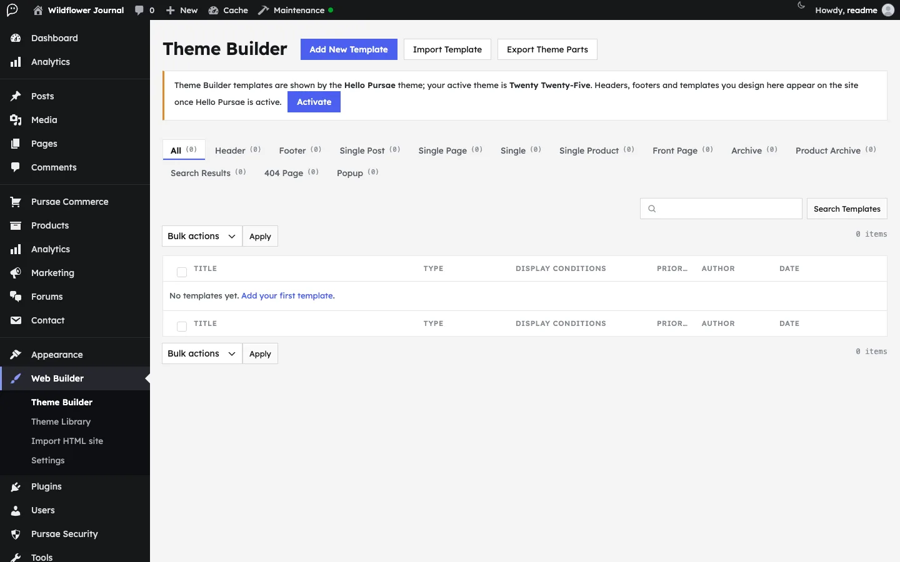<p align="center">Theme Builder: header, footer, templates</p></td>
</tr>
</table>

<p align="right"><a href="docs/developer/web-builder.md">Web Builder →</a> · <a href="docs/developer/web-builder-theme-builder.md">Theme Builder →</a> · <a href="docs/developer/web-builder-theme-library.md">Theme library →</a></p>

### Pursae SEO

Yoast SEO Premium and Rank Math Pro in one plugin, with a WordPress-style admin.

- Per-post box in both editors: focus keyphrase, snippet preview, SEO and readability analysis with traffic lights.
- Search Appearance templates with variables (Rank Math's `%var%` and Yoast's `%%var%%` both work); reads existing Yoast and Rank Math meta.
- Schema, breadcrumbs, XML sitemaps (including news and video), robots and instant indexing.
- Redirections, a 404 monitor, a link counter and a bulk editor.

<table>
<tr>
<td width="50%">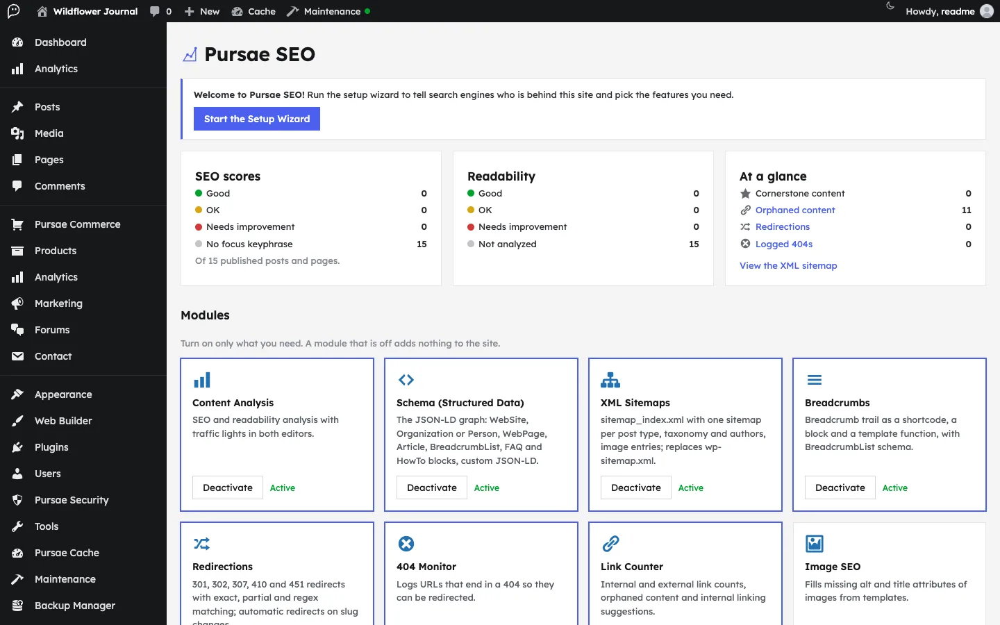<p align="center">Scores &amp; modules</p></td>
<td width="50%">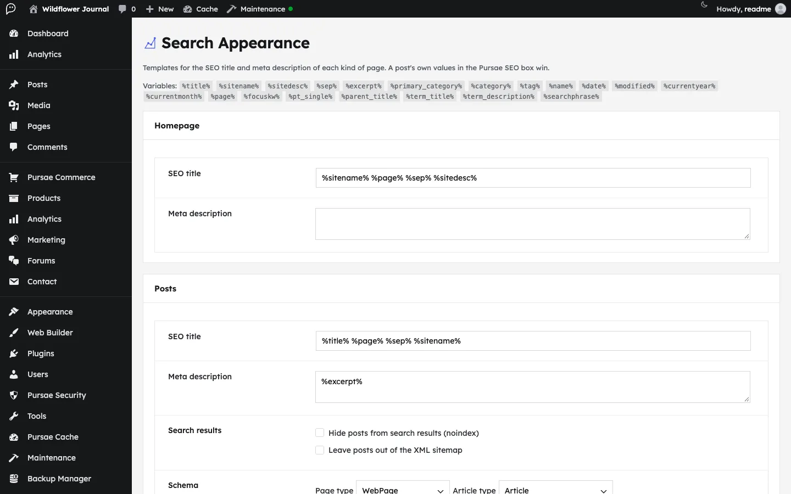<p align="center">Titles &amp; meta</p></td>
</tr>
</table>

<p align="right"><a href="docs/seo-go-features.md">All SEO features →</a></p>

### Pursae Cache

A full-page cache inside the Go process (on by default), modelled on LiteSpeed Cache but working with any server.

- Public pages of logged-out visitors are cached and purged precisely by tag when content changes.
- Can tell a front proxy or CDN to cache too (`auto`, LiteSpeed, nginx or generic headers); optional disk persistence across restarts.
- Page Optimization: lazy-load images, defer scripts, minify HTML, preload the theme's fonts.
- Per-path exclusions and tracking query parameters ignored for the cache key.

<table>
<tr>
<td width="50%">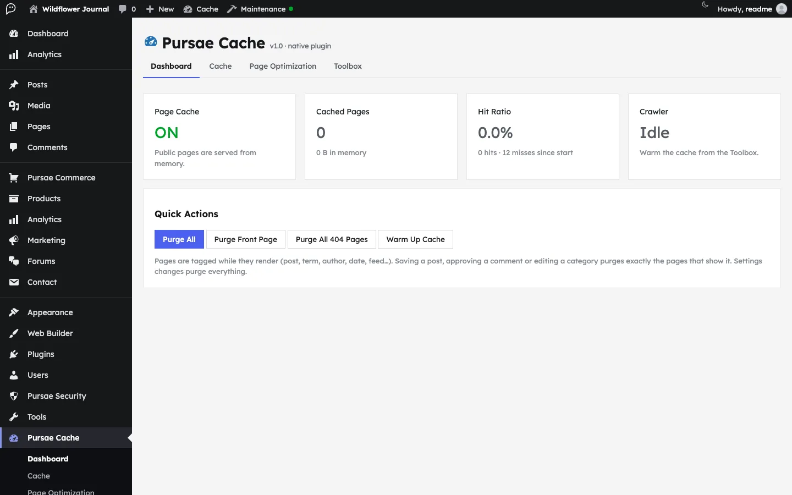<p align="center">Dashboard &amp; purges</p></td>
<td width="50%">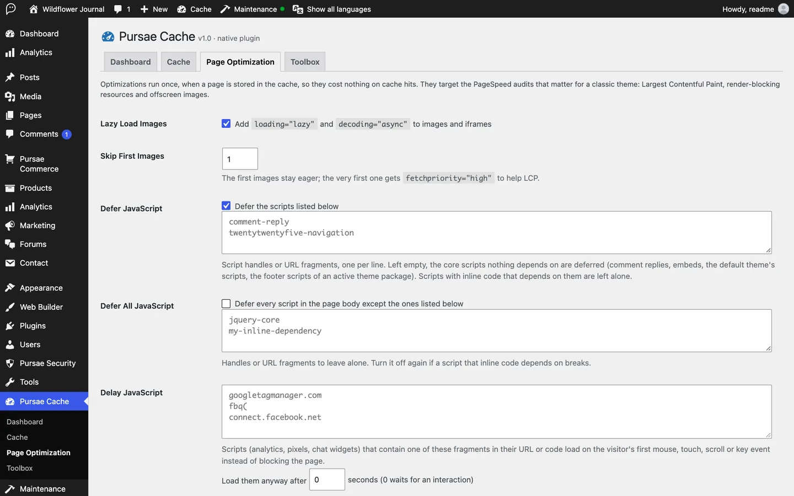<p align="center">Page optimization</p></td>
</tr>
</table>

<p align="right"><a href="docs/developer/operations/caching.md">Caching docs →</a></p>

### Pursae Security

Login security in the class of Wordfence Login Security, Two Factor and WPS Hide Login, plus passkeys.

- **MFA** with e-mailed one-time codes, **2FA** with an authenticator app (TOTP), backup codes and **passkeys** (WebAuthn); enforce them per role.
- Custom login URL; `/wp-login` and `/wp-admin` answer 404 to visitors.
- Lockouts per IP and per username, IP allow and block lists, optional CAPTCHA on login forms.
- Activity log, security headers, file-editor lockdown and a file integrity scan.

<table>
<tr>
<td width="50%">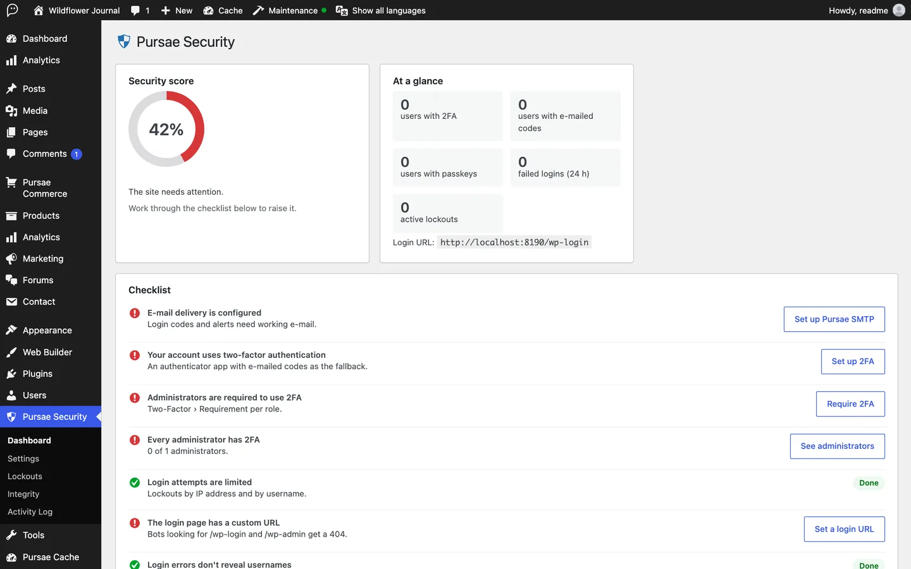<p align="center">Security score &amp; checklist</p></td>
<td width="50%">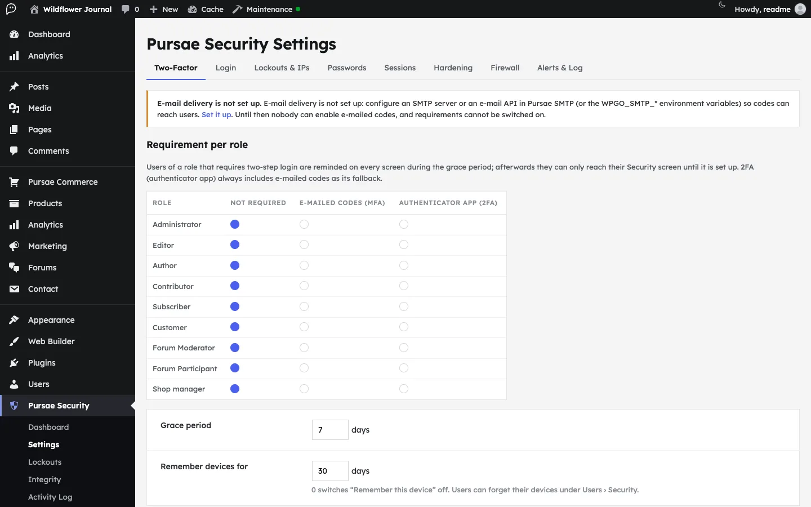<p align="center">2FA per role</p></td>
</tr>
</table>

<p align="right"><a href="docs/adminsecgo-features.md">All Security features →</a></p>

### Pursae CDN

Object storage, CDN delivery and an on-the-fly image service, covering WP Offload Media, an image CDN and CDN Enabler.

- Offload uploads to Amazon S3, Cloudflare R2, DigitalOcean Spaces, Backblaze B2 or any S3-compatible storage, with a connection test and a bulk, resumable job for existing media.
- Image service with resize, crop, quality, **WebP** and **AVIF** output and signed URLs.
- Rewrites theme, plugin and core asset URLs to a pull CDN.
- Purges Pursae Cache and Cloudflare, CloudFront, BunnyCDN, KeyCDN or Fastly.

<table>
<tr>
<td width="50%">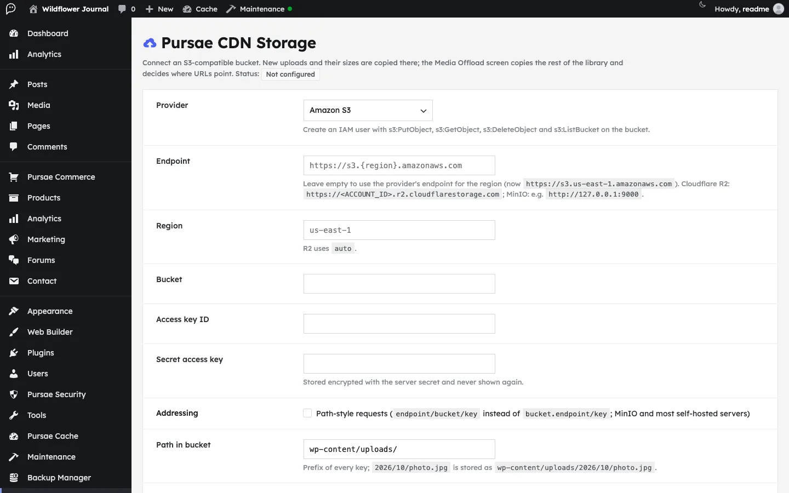<p align="center">S3-compatible storage</p></td>
<td width="50%">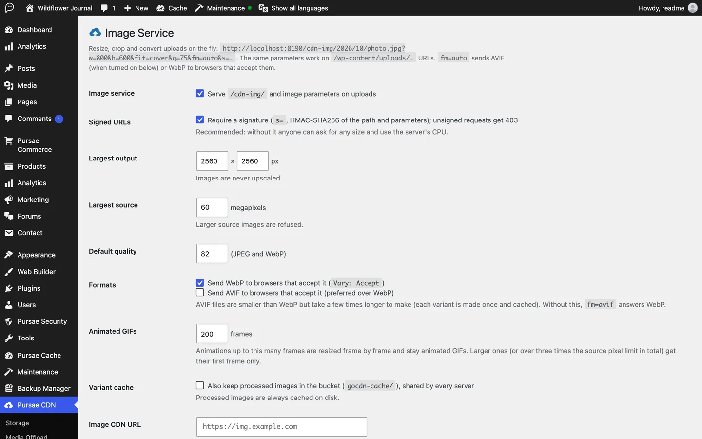<p align="center">On-the-fly WebP image service</p></td>
</tr>
</table>

<p align="right"><a href="docs/gocdn-features.md">All CDN features →</a></p>

### Pursae Headless

A headless CMS next to WordPress: model your own content, deliver it over REST or GraphQL, keep the admin.

- **Content-Type Builder**: collection and single types, components and dynamic zones, relations (also to posts, pages and users).
- Content Manager with draft & publish, scheduled publishing, history, review and i18n through Pursae Multi Language.
- Delivery REST API at `/wp-json/headlessgo/v1` and **GraphQL**, with API tokens, CORS and rate limits.
- Webhooks, preview URLs, and export and import of entries (NDJSON) and schemas.

<table>
<tr>
<td width="50%">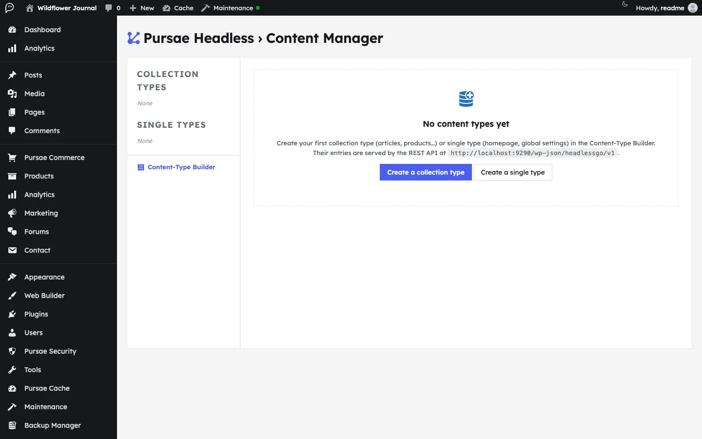<p align="center">Types, entries, API at a glance</p></td>
<td width="50%">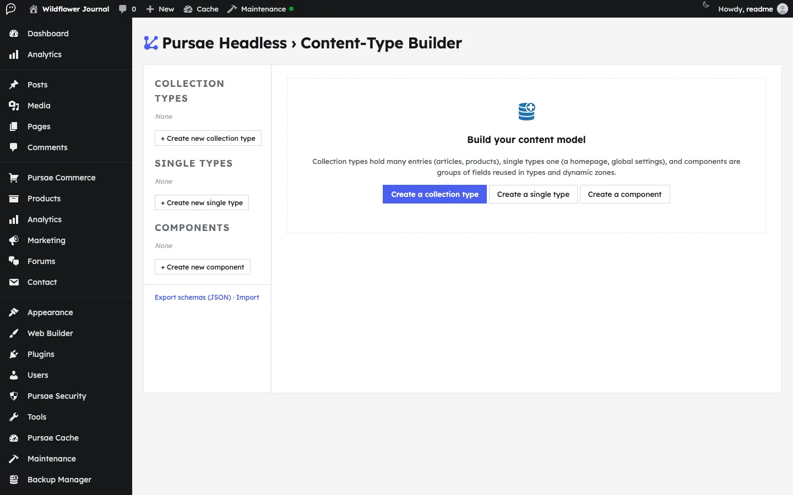<p align="center">Content-Type Builder</p></td>
</tr>
<tr>
<td>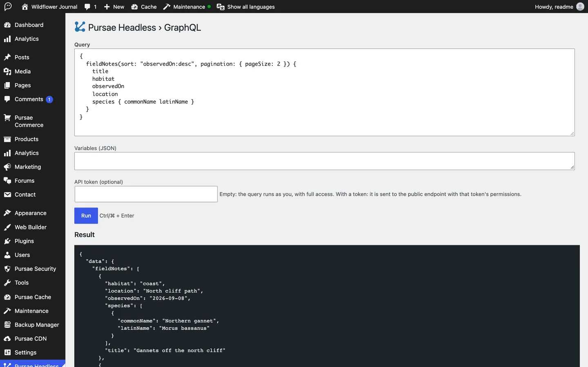<p align="center">GraphQL playground</p></td>
<td></td>
</tr>
</table>

<p align="right"><a href="docs/headlessgo-features.md">All Headless features →</a></p>

### Pursae Cookie

Cookie consent built to comply by design with GDPR / ePrivacy, KVKK, CCPA/CPRA and Google Consent Mode v2.

- Banner with equally prominent **Reject all**, **Accept all** and **Customize**, and a preferences modal per category.
- 14 banner themes, positions and a live preview.
- Script manager that blocks scripts and embeds until consent; cookie declaration and scanner.
- Consent log with CSV export; policy versions re-prompt visitors.

<table>
<tr>
<td width="50%">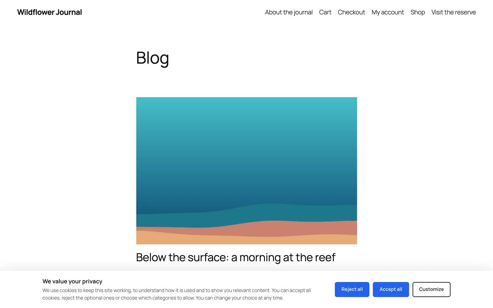<p align="center">14 banner themes</p></td>
<td width="50%">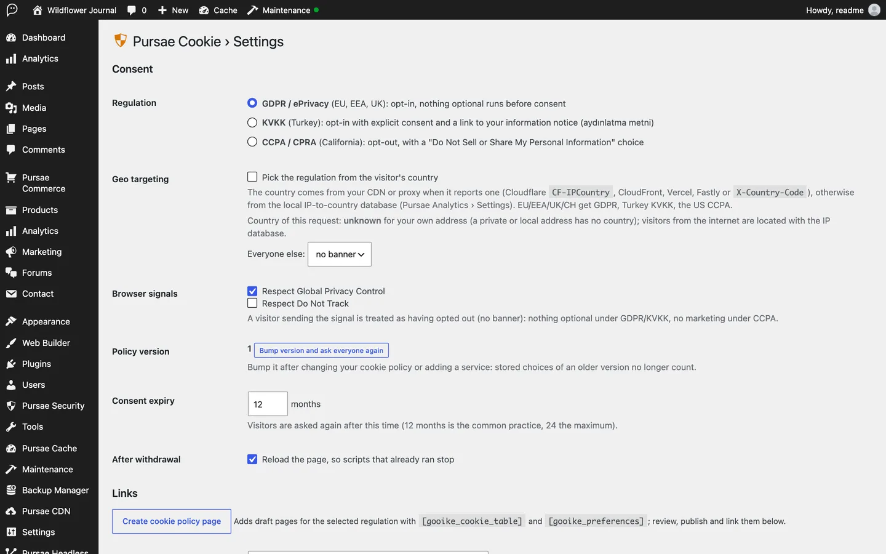<p align="center">Consent dashboard</p></td>
</tr>
</table>

<p align="right"><a href="docs/gooike-features.md">All Cookie features →</a></p>

### Pursae Pixel

Ad and analytics tracking in the class of PixelYourSite Pro and GTM4WP, one event model for every platform.

- Browser tags for Meta, Google Analytics 4, Google Ads, TikTok, Pinterest, Microsoft Advertising and Google Tag Manager; several IDs per platform.
- Server-side delivery with deduplication: Meta, TikTok and Pinterest conversion APIs, and GA4 for purchases.
- Events: page view, search, scroll depth, outbound links, downloads, forms, video and the full WooCommerce funnel.
- Tags stay inert until consent (works with Pursae Cookie); product catalog feed.

<table>
<tr>
<td width="50%">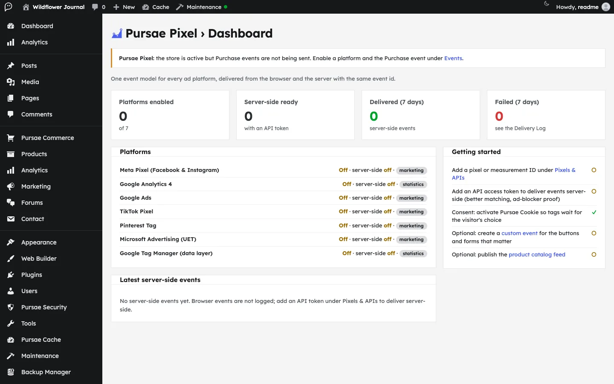<p align="center">All platforms at a glance</p></td>
<td width="50%">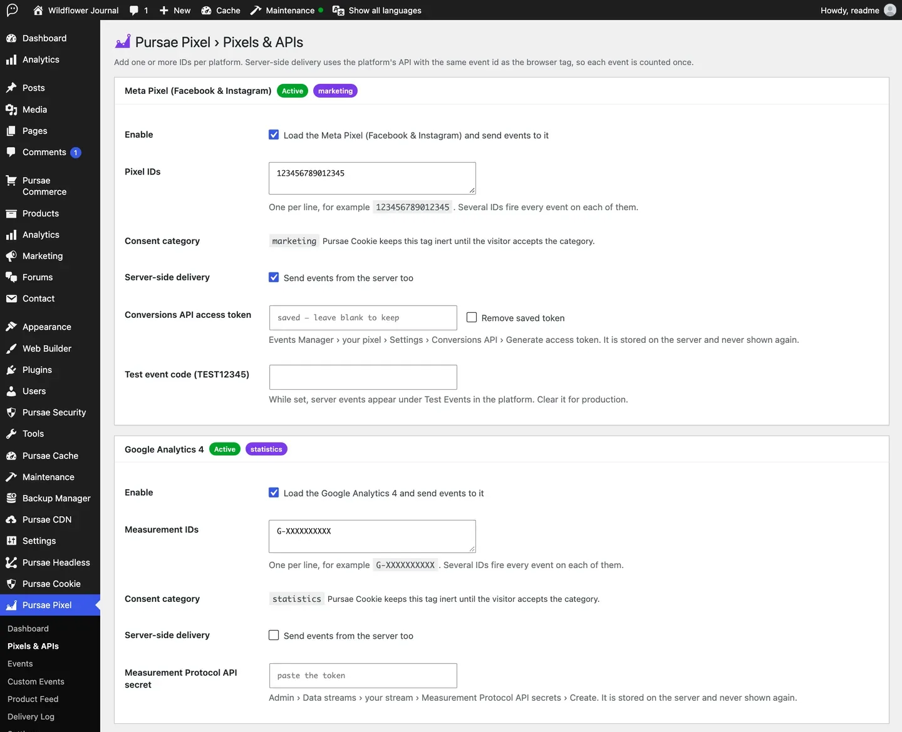<p align="center">Pixels &amp; Conversions APIs</p></td>
</tr>
</table>

<p align="right"><a href="docs/pixelgo-features.md">All Pixel features →</a></p>

### Pursae Analytics

Privacy-friendly site statistics on one page (**Analytics** in the admin menu), without cookies, without
storing IP addresses and without a consent banner, in the class of Plausible and Jetpack Stats.

- **Visitors, visits, page views**, views per visit, bounce rate and visit duration, each compared with the previous period, a chart and live visitors.
- **Top and entry pages, sources** (Google, ChatGPT, social networks, other sites), **UTM campaigns**, countries, devices, browsers and operating systems.
- **Goals**: outbound link clicks, file downloads, form submissions and 404s.
- **Real-user Core Web Vitals**: LCP, INP, CLS, FCP and TTFB at the 75th percentile, site-wide and for the slowest pages.
- A 2.3 KB script (1.2 KB gzipped) that works behind the page cache; visitors are counted with a daily salted hash that cannot be followed across days. JSON summary at `GET /pursae/v1/analytics`.

<table>
<tr>
<td width="50%">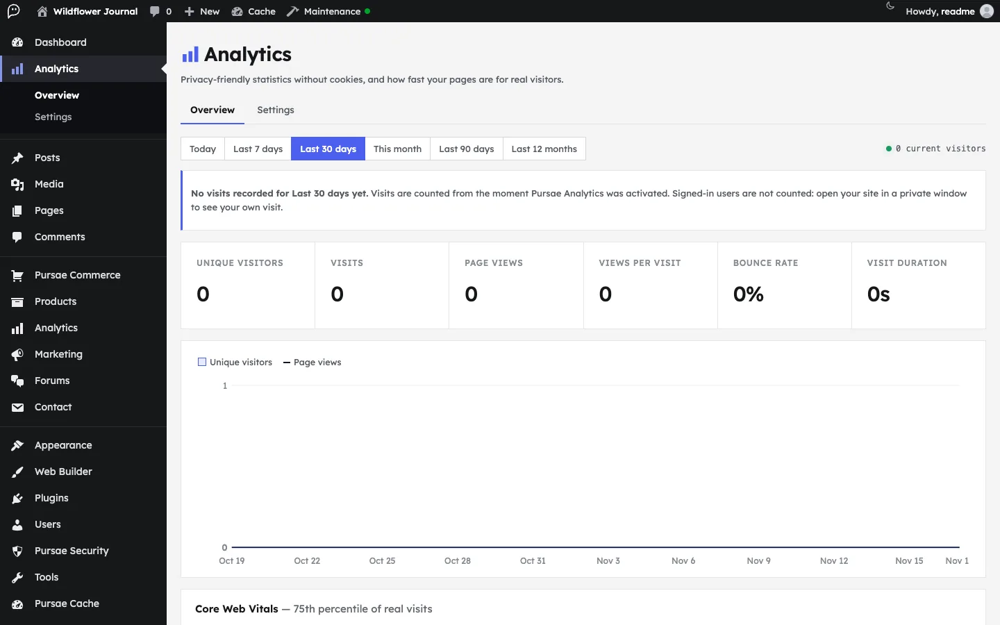<p align="center">Visitors, views and Core Web Vitals</p></td>
<td width="50%">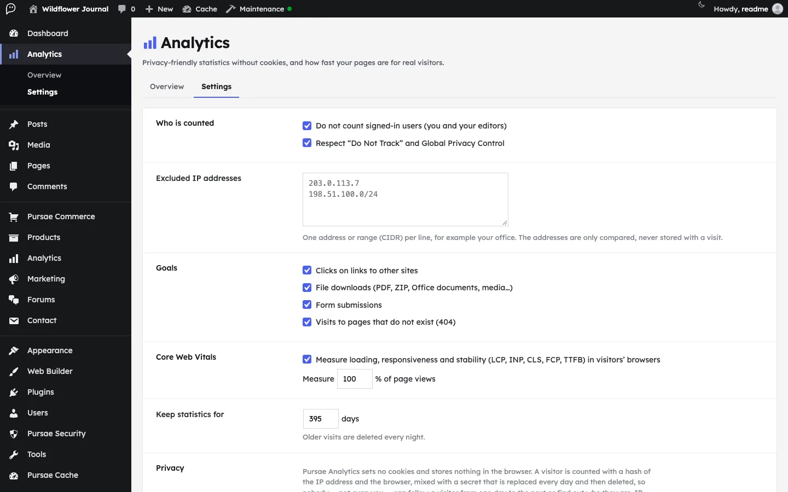<p align="center">Who is counted, goals, retention</p></td>
</tr>
</table>

<p align="right"><a href="docs/analytics-features.md">All Analytics features →</a></p>

### Pursae Forum

A bbPress-class discussion board that renders inside any theme (**Forums** in the admin menu).

- **Categories, forums, topics and replies**, pinned and closed topics, search, profiles and a member list — all plain forms, no JavaScript.
- **Membership on the front end**: email sign-up with confirmation, "Continue with Google" (OAuth with PKCE), an account page with profile photos.
- **Levels and badges**: points for topics and replies, six default levels, rule-based and hand-awarded badges with icons or images.
- **Moderation**: approve, pin, close, spam, trash and block from the post itself or the admin queue; first-post moderation, flood and hourly limits.
- **Themes**: four forum themes with demo content (Campfire, Devboard, Guild Hall, Study Circle), `--pf-*` design tokens and per-view template overrides; works with Pursae Web Builder and Pursae Multi Language. REST API at `/wp-json/forum/v1`: public read routes (forums, topics, replies, tags, stats, online counts and more), plus community write routes — a view beacon and presence (no login), and likes, reports, follows, solutions, previews and drafts for logged-in members (cookie + `X-WP-Nonce` or an Application Password). See [the endpoint list](docs/developer/rest-api/endpoints.md#pursae-forum-forumv1).

<table>
<tr>
<td width="50%">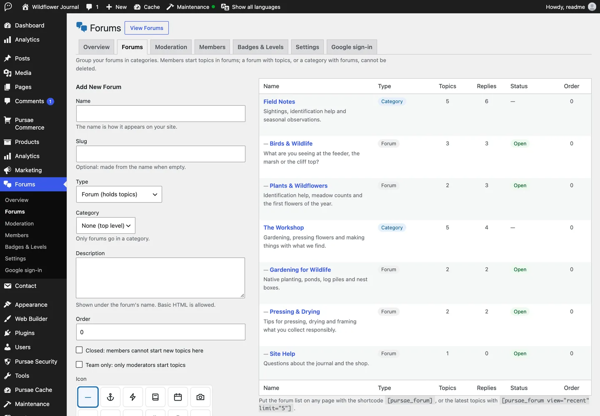<p align="center">Overview, moderation, members, badges</p></td>
<td width="50%">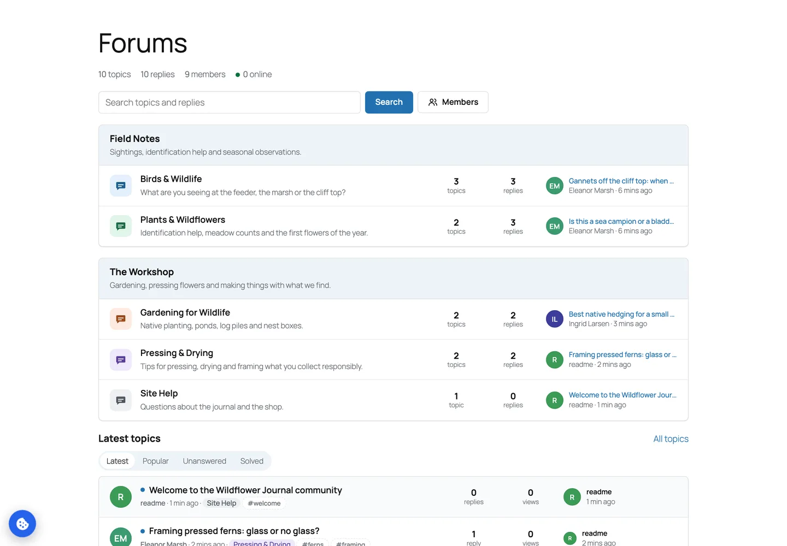<p align="center">Campfire theme with its demo content</p></td>
</tr>
</table>

<p align="right"><a href="docs/forum-features.md">All Forum features →</a> · <a href="docs/developer/themes/forum.md">Making a forum theme →</a></p>

### Pursae SMTP

A native clone of WP Mail SMTP (Lite and Pro): send site mail through a real mailer instead of the server.

- Mailers: Other SMTP, SendLayer, SMTP.com, Brevo, Mailgun, SendGrid, Postmark, SparkPost, Amazon SES, Microsoft 365 / Outlook, Gmail, Zoho Mail, Elastic Email and Mailjet.
- Setup wizard and a connection test; secrets are stored sealed.
- Email log and email reports, alerts and email controls.
- Plain `PURSAE_SMTP_*` environment variables keep working while the plugin is off.

<table>
<tr>
<td width="50%">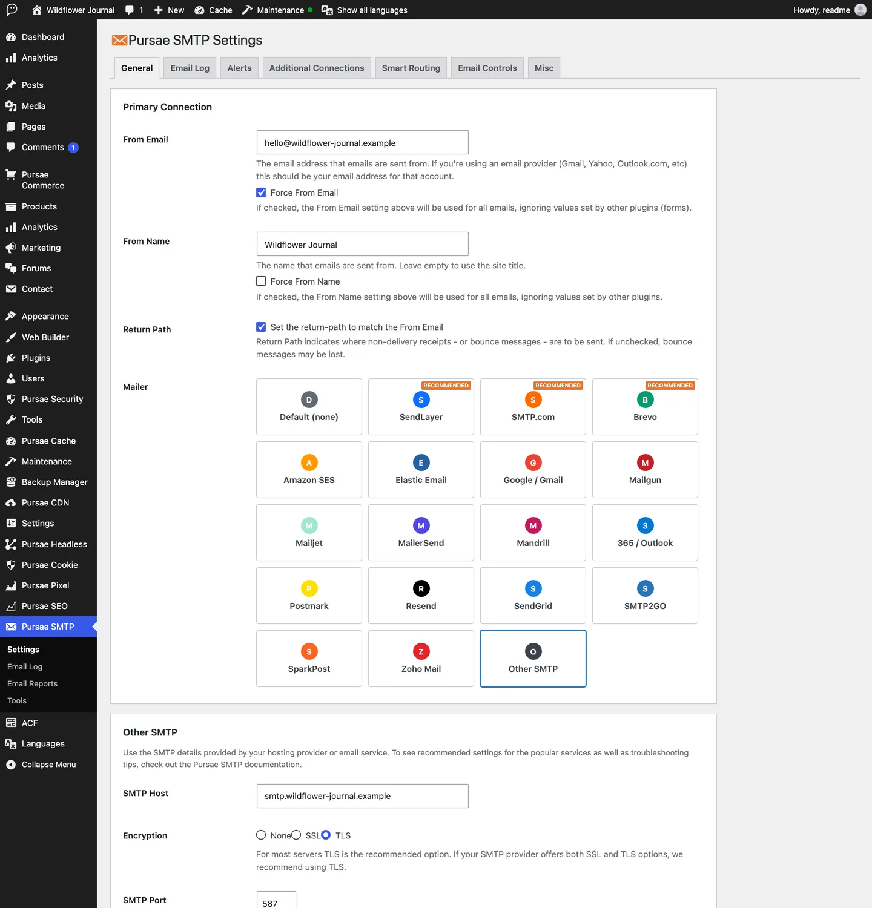<p align="center">Pick a mailer</p></td>
<td width="50%">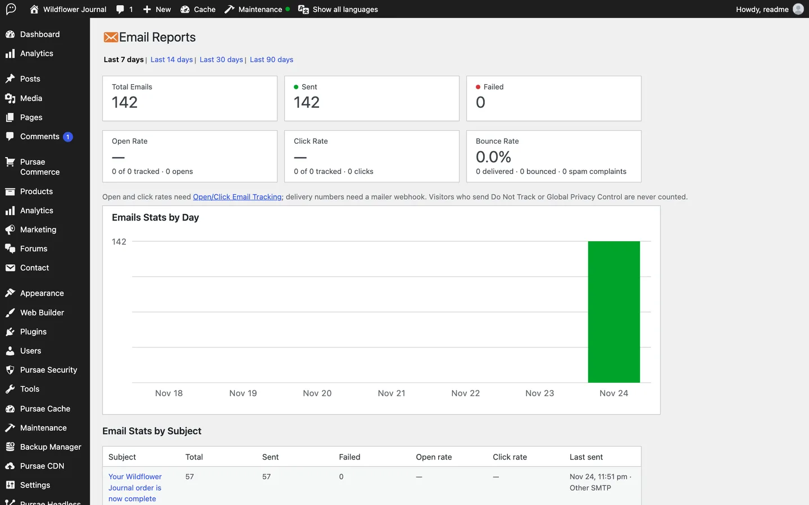<p align="center">Email reports</p></td>
</tr>
</table>

<p align="right"><a href="docs/wpgo-mail-smtp-features.md">All SMTP features →</a></p>

### Pursae Custom Fields

A native clone of Advanced Custom Fields PRO 6.x.

- Field groups with all of ACF's field types, location rules, conditional logic and validation.
- Options pages, and a UI for custom post types and taxonomies.
- ACF Blocks, a REST field and the template functions themes expect.
- Field groups and saved values are kept when the plugin is deactivated.

<table>
<tr>
<td width="50%">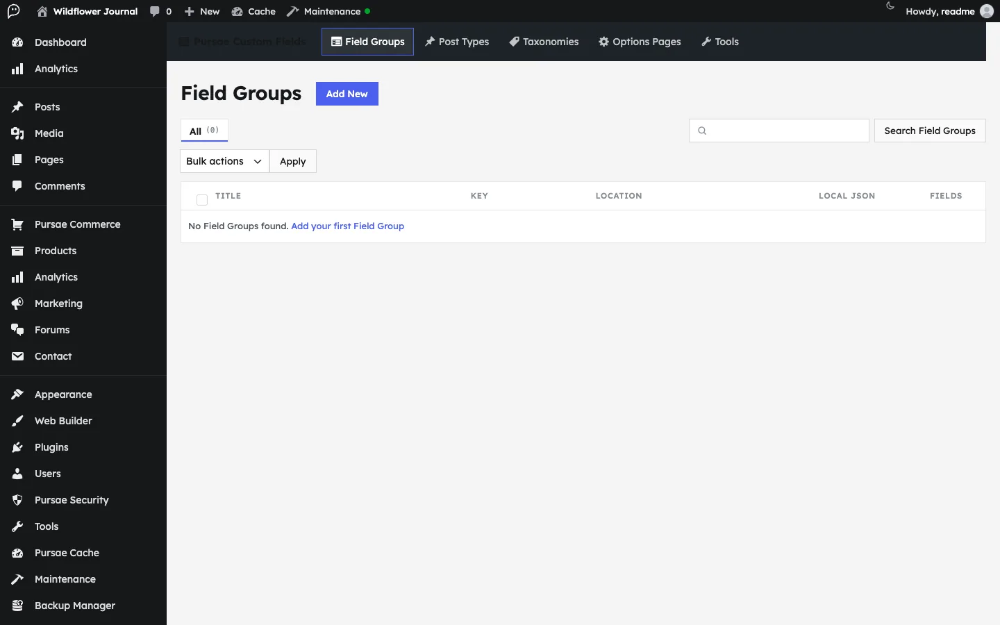<p align="center">Field Groups</p></td>
<td></td>
</tr>
</table>

<p align="right"><a href="docs/acf-go-features.md">All Custom Fields features →</a></p>

### Pursae Multi Language

A functional clone of Polylang Pro, with TranslatePress-style extras.

- Languages from the directory (`/fr/`), a subdomain, a domain or content; per-language menus, site title and sitemaps.
- `hreflang` links, `<html lang>` and RTL support, and a language switcher.
- Visual translation of a page and automatic capture of theme, plugin and builder text.
- Machine translation with DeepL, Google or an OpenAI-compatible API.

<table>
<tr>
<td width="50%">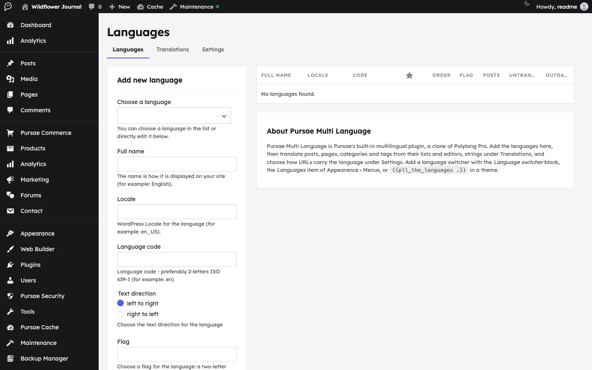<p align="center">Languages</p></td>
<td></td>
</tr>
</table>

<p align="right"><a href="docs/golylang-features.md">All Multi Language features →</a></p>

### Pursae Contact Form

A native clone of Contact Form 7: same post type, form-tags and behaviour.

- Form and mail templates, embedded with a shortcode or a block.
- Spam guard: reCAPTCHA v3, Cloudflare Turnstile, a built-in image CAPTCHA, a quiz and disallowed keys.
- Validation and a response message per form.
- Akismet is not supported.

<table>
<tr>
<td width="50%">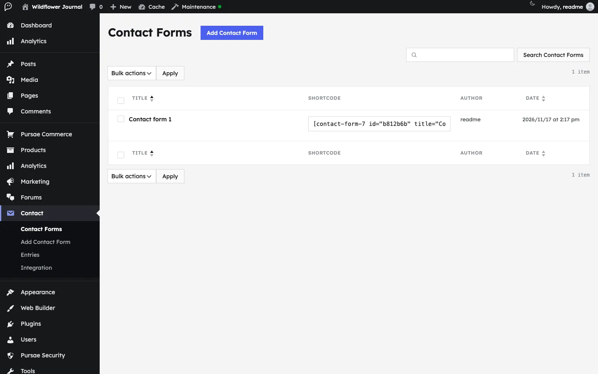<p align="center">Forms</p></td>
<td width="50%">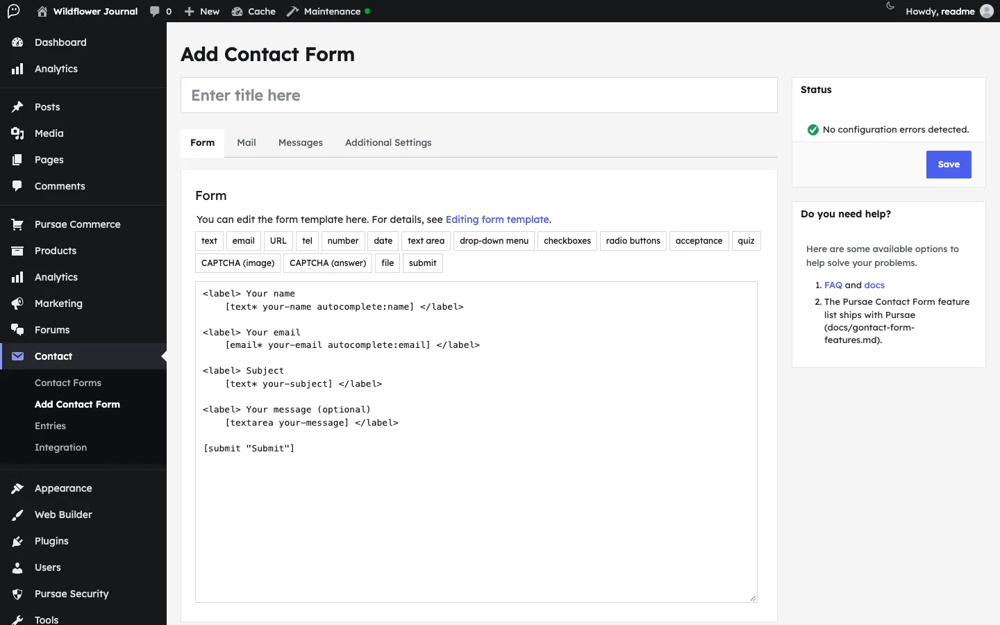<p align="center">Form and mail templates</p></td>
</tr>
</table>

<p align="right"><a href="docs/gontact-form-features.md">All Contact Form features →</a></p>

### Pursae Maintenance

A maintenance or coming-soon page, covering Maintenance by WebFactory and parts of its PRO version.

- **Maintenance** mode answers HTTP 503 with `Retry-After`; **Coming Soon** mode answers 200.
- `noindex`, no-cache headers, and a switch to show the normal site to crawlers.
- A status badge on the menu and an indicator in the admin bar.
- Meta description, favicon and image picked from the Media Library.

<table>
<tr>
<td width="50%">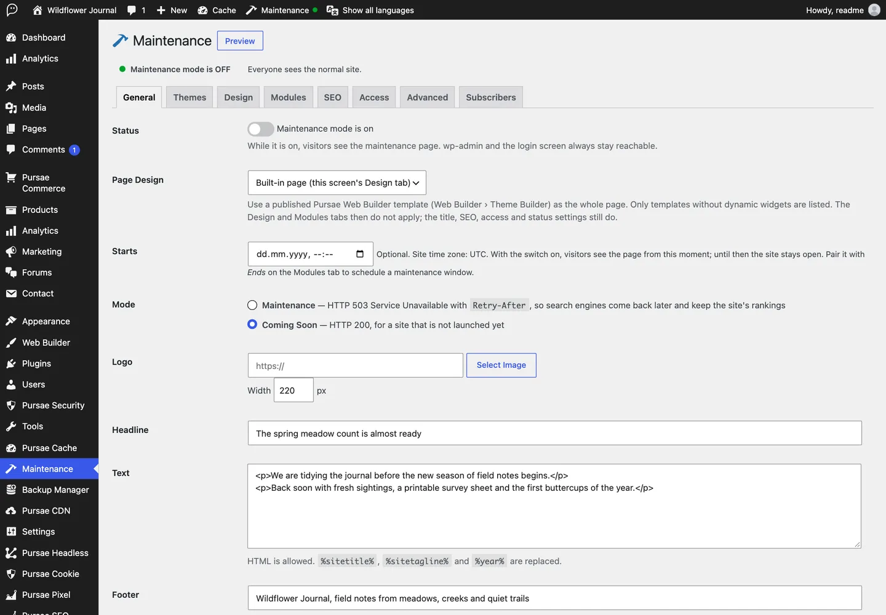<p align="center">Maintenance</p></td>
<td></td>
</tr>
</table>

<p align="right"><a href="docs/maintenance-go-features.md">All Maintenance features →</a></p>

### Pursae Backup Manager

Back a whole site up into one `.zip` and restore it on the same or another Pursae site. No `pg_dump` needed.

- Pick what goes in: posts, media, users, settings, themes, plugins, page builder and each plugin's data.
- Restore runs in one transaction and rolls back on any failure; a safety snapshot is taken first by default.
- Scheduled daily or weekly backups with a retention count.
- Copy backups, encrypted first, to S3-compatible storage; rewrite the old site address on restore.

<table>
<tr>
<td width="50%">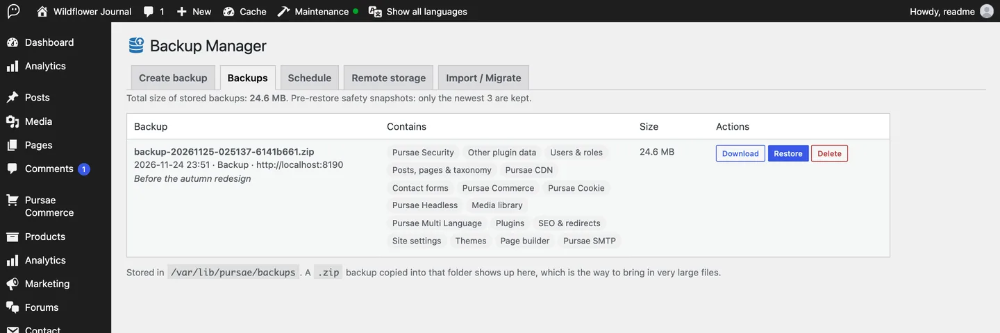<p align="center">Backup Manager</p></td>
<td></td>
</tr>
</table>

<p align="right"><a href="docs/backup-manager-features.md">All Backup Manager features →</a></p>

### Classic Editor

TinyMCE and Quicktags editing with Add Media and featured images, on by default. Each user can choose the
Classic editor or the Pursae Editor (block editor) under **Users › Profile**. See the [guide](docs/GUIDE.md).

## AI agents (MCP)

<table><tr>
<td width="50%">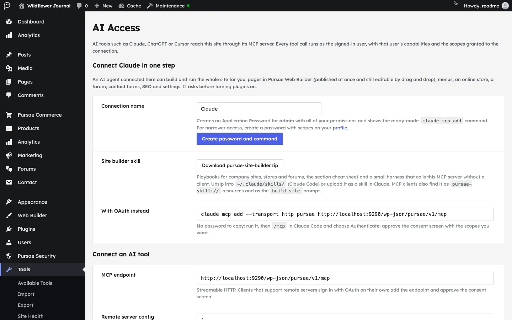<p align="center"><b>Tools › AI Access</b> — endpoint, client configs, connected apps, activity log</p></td>
<td width="50%">

A built-in [Model Context Protocol](https://modelcontextprotocol.io) server at `/wp-json/pursae/v1/mcp`
lets Claude, Cursor and other MCP clients run the site:

- Posts, pages, media, terms, menus, comments, users, themes and theme files, plugins, updates,
  backups, Pursae Cache, SEO, Commerce, Headless and the built-in plugins' settings.
- Sign-in with **OAuth 2.1** (a consent screen in the browser) or an **Application Password** with
  scopes; every tool runs as a REST request with the same capabilities.
- `pursae mcp` bridges clients that only start local (stdio) servers.
- Every write is logged for 90 days; revoke a client under Users › Profile.

<a href="docs/developer/operations/ai-mcp.md">AI agents (MCP) →</a>

</td>
</tr></table>

## WordPress compatibility

- **Admin**: the WordPress admin markup and CSS 1:1 under `/wp-admin/` (old `.php` URLs still work). The Classic admin theme is the default; Pursae Modern is an optional beta theme.
- **Editors**: the real block editor (`@wordpress/*` bundles) and a built-in Classic Editor.
- **REST API**: `wp/v2` with cookie + nonce and Application Passwords; `wc/v3` with Commerce on — [REST docs](docs/developer/rest-api/index.md).
- **Content**: WXR import and export under Tools; WooCommerce's product CSV under Products.
- **Not supported**: see below.

### Not supported

- Full Site Editing and the Site Editor: design the header, footer, templates and site style with [Pursae Web Builder's Theme Builder](docs/developer/web-builder-theme-builder.md) instead ([coming from the Site Editor](docs/developer/web-builder-site-editor.md)). `wp/v2/templates`, `template-parts` and `global-styles` are stubs that return empty data; on import, block theme navigation menus become menus and the other Site Editor items are counted and skipped.
- Multisite.
- XML-RPC.
- Incoming pingbacks and trackbacks (Pursae can send trackbacks, not receive them).
- REST: `wp/v2/plugins`, `wp-site-health/v1` and `wp/v2/font-families` (plugins and site health are managed under `pursae/v1`).
- PHP plugins and PHP themes: themes are Go templates with a [`theme.json` manifest](docs/developer/themes/theme-json.md), plugins are Wasm.

## Go architecture

- One static binary (`CGO_ENABLED=0`) with the admin, the editors and the bundled themes embedded.
- [gin](https://github.com/gin-gonic/gin) for HTTP, [pgx](https://github.com/jackc/pgx) on PostgreSQL 16 or 17 (CI tests both); migrations run on start.
- Plugins run as WebAssembly in [wazero](https://wazero.io) — no cgo, no separate runtime.
- Details: [What is Pursae](docs/developer/getting-started/index.md) · [binary install](docs/developer/getting-started/install-binary.md).

### The WordPress ecosystem without PHP

- **Plugins** are Go compiled to signed Wasm, sandboxed and permission-gated — [plugin docs](docs/developer/plugins/index.md), [signing](docs/developer/plugins/packaging-and-signing.md).
- **Built in**: the [18 plugins above](#built-in-plugins) ([what each replaces](docs/developer/benchmarks.md#whats-built-in)).
- **Themes** are zip packages of templates and assets with no Go code in them — [theme packages](docs/theme-package.md); a marketplace of both on the [Hub](docs/developer/hub/index.md). A theme can still ship JavaScript that runs on your site, so install only themes you trust; the settings functions of theme templates return only the site's public settings.

## Performance benchmarks

Same content (1000 posts, 200 products), Twenty Twenty-Five, same container limits; WordPress 7.1.4 + PHP 8.3 OPcache
against Pursae 0.1.9, Apple M2 Pro under Docker, 2026-11-09:

| | WordPress | Pursae |
|---|---:|---:|
| Single post, no page cache | 58 req/s | **394 req/s** |
| Single post with the usual plugins (Woo, Yoast, Polylang, ACF, Elementor, CF7 vs built-ins) | 19 req/s | **232 req/s** |
| DB queries, home page with those plugins | 139 | **16** |
| Memory idle, whole stack | 233 MiB | **95 MiB** |

Cached pages tie (WP Super Cache + nginx ≈ Pursae Cache), cold start is the same, and WordPress' page cache serves
search while Pursae's does not. Method, every config, all tables and `make bench`: [benchmarks](docs/developer/benchmarks.md).

## Security

- Core secure by default: argon2id, login throttling, nonces, CSP and security headers, no account enumeration, sandboxed uploads — [security](docs/developer/operations/security.md).
- Plugins are signed and sandboxed; a site installs only packages whose signature it trusts.
- Multi-role users: capabilities are the union of the roles, with per-user allow and deny — deny wins.
- **Pursae Security** adds 2FA, lockouts, a custom login URL and an activity log — [features](docs/adminsecgo-features.md).
- Found a vulnerability? Report it privately, as the [security policy](SECURITY.md) explains.

## Installation & migration

- **Docker** ([Quick start](#quick-start)) or **one binary** against your own PostgreSQL — [install the binary](docs/developer/getting-started/install-binary.md).
- **Can I move my site?** Yes. Install the **WP to Pursae** plugin on the WordPress site and click *Move to Pursae*. Users (they keep their passwords), content, media, menus, settings and the whole WooCommerce store (products, orders with refunds, customers, coupons) move in one go — [migrate from WordPress](docs/developer/operations/migrate-from-wordpress.md).
- **Content only**: export with Tools › Export (WXR), import with Tools › Import here — posts, pages, terms, comments, menus, media fetched from their public URLs, and WooCommerce products into Pursae Commerce; no passwords, settings or orders — [content export and import](docs/developer/operations/backups.md#content-export). WooCommerce's product CSV works too.
- PHP plugins and themes never move: Pursae does not run PHP.
- **Pursae to Pursae**: Backup Manager moves a whole site in one archive — [Backup Manager](docs/backup-manager-features.md).

## What Pursae sends to hub.pursae.com

Every production build talks to **Pursae Manager at https://hub.pursae.com**. It is how a site gets
updates, the theme and plugin marketplace and licenses. Here is everything it sends, plainly:

| When | What |
|------|------|
| Once a day (also right after installation and a minute after a core update) | the site's URL, Pursae version and license key (if you entered one). With **usage statistics** on (the default) also: language, OS and CPU architecture, active theme, and the list of installed plugins and themes with their versions, whether they are active, and where they came from (built in, from the Hub, uploaded) |
| In the same daily ping, only for users who opted in | the **e-mail address, display name and role** of each user who asked for Pursae product update e-mails: the unticked box on the install screen, or the "Pursae updates" switch in that user's own profile. Only users who work in the admin (`edit_posts`) are asked, at most 50 per site; the time of consent is kept on the site. This is a per-user choice, separate from the statistics switch, and sent whatever that switch says; when a user turns it off, the next ping removes the address from the Manager. Nobody is opted in by default, and subscribers and shop customers are never asked nor sent |
| As it happens (sent in batches), only with usage statistics on | what was done with packages: a plugin installed, updated, activated, deactivated or deleted; a theme installed, updated, activated, previewed or deleted; a demo imported; the core updated — each with the slug, version and time |
| On every request to the Hub | the site's URL and license key as headers (`X-Pursae-Site`, `X-Pursae-License`) and the site's URL in the User-Agent; the Hub also sees the server's IP address, as any web server does |

**Usage statistics** can be switched off under **Settings › License** ("Send usage statistics to Pursae
Manager", the `pursae_send_stats` option). Off, the daily ping carries only the site's URL, version
and license key (and the opted-in contacts above), and no events are queued.

**Local sites report nothing.** A site whose address is local (`localhost`, `*.localhost`, `*.local`,
`*.test`, or a loopback, private or link-local IP) sends no daily ping, no contacts and no events. It
still reads the Manager's catalogue and update information (with the headers of the last row), but
development and test installs never show up among the Manager's sites or in its statistics.

The Hub uses this for the numbers you see on it (theme and plugin download and install counts, which
versions sites run), to decide what a license unlocks, and to send product update e-mails to the users
who asked for them. **Apart from those opted-in contacts it never receives your content, users,
e-mail addresses, passwords, visitors, orders or anything else from your database.**

What a site gets back:

- **Updates**: the newest Pursae release, offered under **Dashboard › Updates** and installed with
  one click. Every core binary is signed by the Hub with a key endorsed by the Pursae release key
  built into your binary; the site refuses anything else.
- **Plugins**: Wasm plugins from the marketplace, each signed; by default a site installs only
  packages whose signature it can verify.
- **Themes**: the theme library with demo content, checked against their SHA-256.
- **Licenses** for pro and beta packages, and the product logo.

**Turning it off.** Set `PURSAE_HUB=off` in the environment (with Docker: in `docker/.env`) and restart;
the site then sends nothing to hub.pursae.com. **We do not recommend it**: the site gets no update
notices or one-click updates — security fixes included —, no marketplace, no signed plugins and no
licenses, and you have to replace the binary yourself for every release. While it is off, every admin
page says so; remove `PURSAE_HUB` and restart to get updates again.

## Build on it

| | |
|---|---|
| 🧩 **Plugins** — Go → signed Wasm, hooks, REST, settings | [docs/developer/plugins](docs/developer/plugins/index.md) |
| 🎨 **Themes** — Go templates + theme.json | [docs/developer/themes](docs/developer/themes/index.md) |
| 💬 **Forum themes** — Pursae Forum wrapper, view overrides, `--pf-*` tokens | [docs/developer/themes/forum.md](docs/developer/themes/forum.md) |
| 🔗 **REST API** — `wp/v2` + plugin routes, Application Password scopes, OAuth 2.1 | [docs/developer/rest-api](docs/developer/rest-api/index.md) |
| ⌨️ **Command line** — `pursae` (deprecated alias `wpgo`), WP-CLI style `pursae post list`, `pursae help` | [docs/developer/operations/cli.md](docs/developer/operations/cli.md) |
| 🤖 **AI agents** — MCP server, `pursae mcp` bridge, tool list | [docs/developer/operations/ai-mcp.md](docs/developer/operations/ai-mcp.md) |
| 🏪 **Hub** — marketplace, updates, licenses | [docs/developer/hub](docs/developer/hub/index.md) |
| ⚙️ **Operations** — config, TLS, backups, cron | [docs/developer/operations](docs/developer/operations/configuration.md) |
| 🧷 **Compatibility** — what stays stable in 0.5.x, deprecations, versioning | [docs/developer/compatibility.md](docs/developer/compatibility.md) |

## More

[Full guide](docs/GUIDE.md) (install, configuration, troubleshooting, project layout) ·
[Developer docs](docs/developer/README.md) · [License](LICENSE) · [Notice](NOTICE)

<sub>GPL-2.0-or-later. "WordPress" is a trademark of its owner; Pursae is not affiliated with it.</sub>
